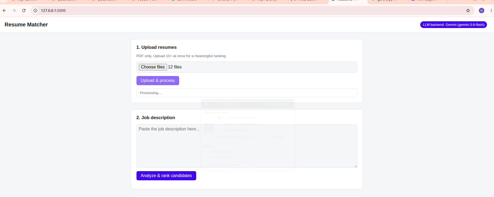
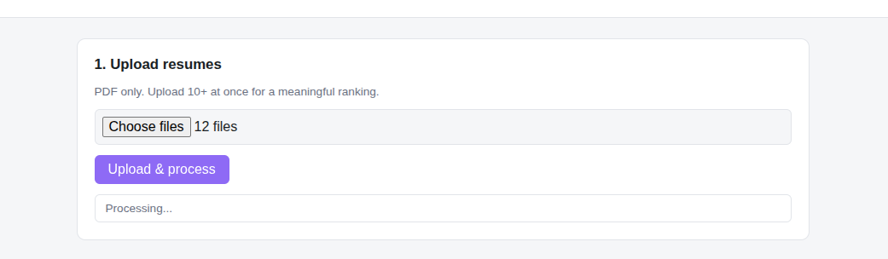
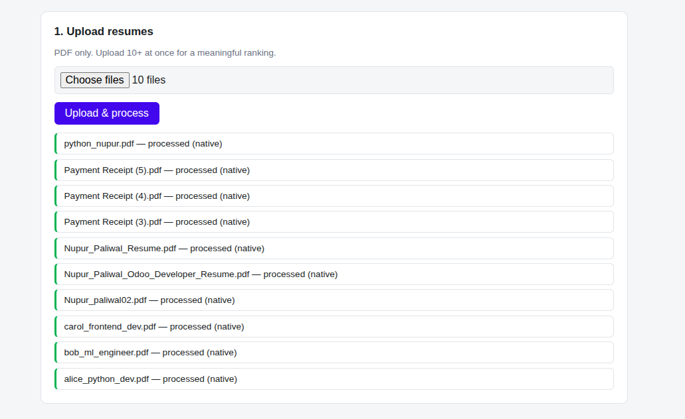
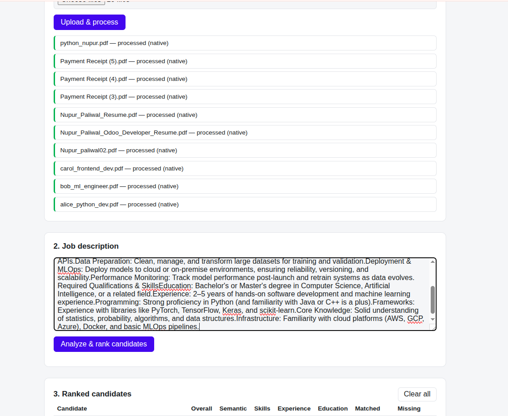
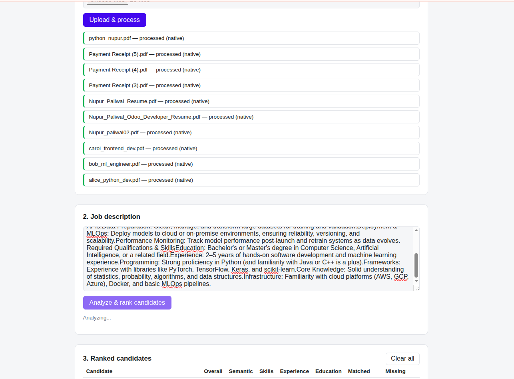
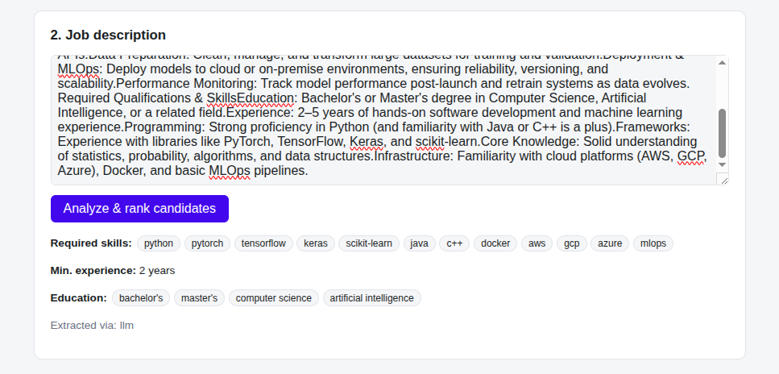
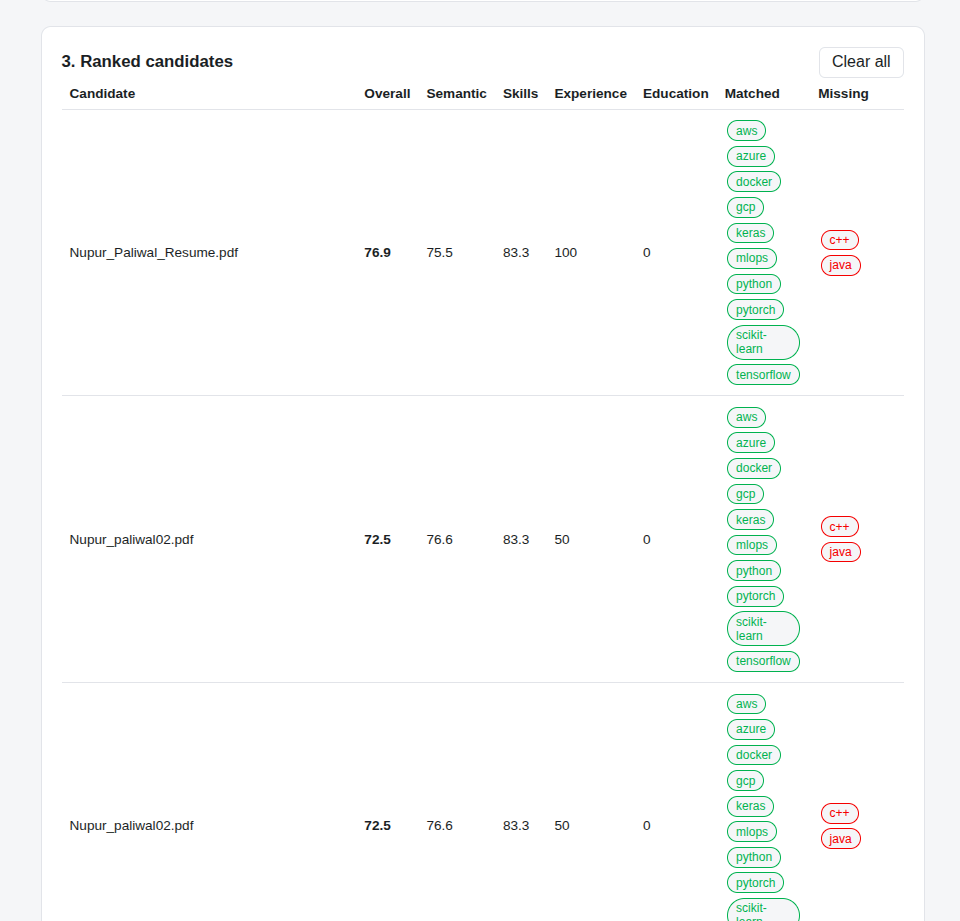
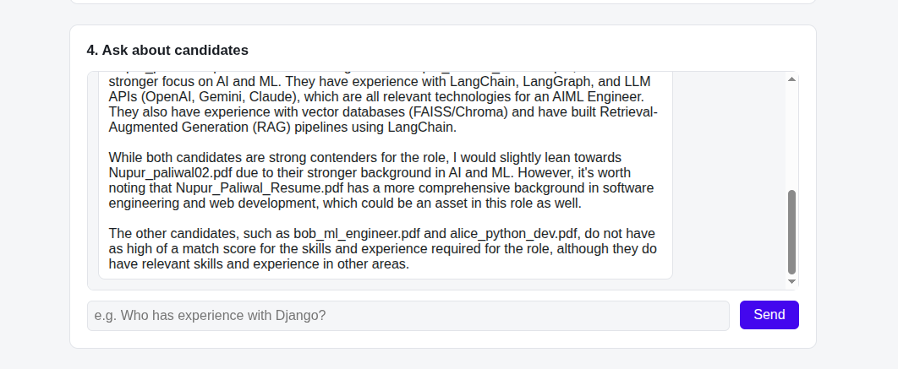
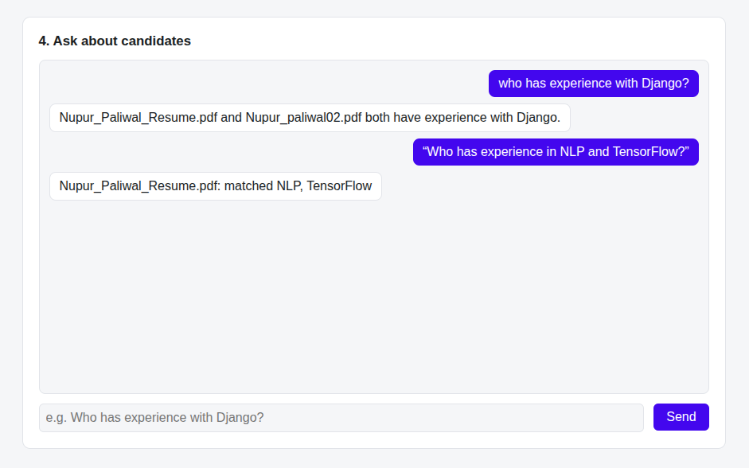

# Resume Matcher

An AI-based resume matching application: upload multiple candidate resumes (PDF), provide a job description, and get a ranked, explainable match score per candidate plus a chatbot to ask natural-language questions about the candidate pool.

Built with Flask, LangChain, a local Chroma vector store, and a hybrid LLM backend that uses Gemini when an API key is configured and transparently falls back to a local Ollama model otherwise — so the whole app works fully offline with no API key.

## Features

- **Bulk resume upload** — multiple PDFs at once, with per-file processing status.
- **Text extraction with OCR fallback** — native PDF text via PyMuPDF, falling back to Tesseract OCR per-page for scanned/image resumes.
- **Job description analysis** — extracts required skills, minimum experience, and education requirements from pasted JD text.
- **Explainable ranked matching** — each candidate gets an overall score (0–100) broken into semantic similarity, skills overlap, experience, and education components, plus explicit matched/missing skill lists.
- **RAG chatbot** — ask things like *"Who has experience with Django?"* or *"Who is more suitable for this position?"*; answers are grounded in retrieved resume excerpts, the active job description, and the precomputed match scores (not just free-form LLM guessing).
- **Dual LLM backend with graceful degradation** — Gemini (if `GOOGLE_API_KEY` is set) → local Ollama → deterministic rule-based fallback, at every stage (parsing, scoring, chat), so the app never hard-fails just because no LLM is reachable.

## Architecture

```
Flask (app.py)
 ├─ extraction.py       PDF → text (PyMuPDF, Tesseract OCR fallback)
 ├─ resume_parser.py    text → structured fields (LLM, rule-based fallback)
 ├─ jd_parser.py        JD text → structured requirements (LLM, rule-based fallback)
 ├─ vector_store.py     Chroma-backed per-candidate chunk index (RAG retrieval)
 ├─ scoring.py          semantic similarity + tiered skill/education matching → match score
 ├─ chatbot.py          retrieve (vector_store) + ground (JD, scores) + generate (LLM)
 ├─ llm_provider.py     Gemini / Ollama selection, cached singleton
 └─ storage.py          simple JSON persistence for candidates + active JD
```

**Why LangChain for the LLM/RAG layer but not for PDF/OCR handling:** the Gemini↔Ollama fallback we need is close to free in LangChain (`ChatGoogleGenerativeAI` and `ChatOllama` share the same `.invoke()` interface), and Chroma + embeddings integration is standard LangChain plumbing. PDF extraction and the "try native text, fall back to OCR" logic is app-specific and doesn't benefit from a framework, so it's hand-rolled.

**Why skill matching isn't a single embedding/LLM call.** Short skill-jargon words don't embed well for similarity (`tensorflow` vs `rag` cosine similarity is ~0.3–0.4 with `all-MiniLM-L6-v2`, far below any usable threshold), and small local models were empirically shown to reason unreliably about skill relatedness. So `scoring.py` checks skills in three tiers:
1. **Exact match** (case-insensitive).
2. **Curated skill clusters** (`skills_taxonomy.py`) — e.g. LangChain/RAG experience counts toward a TensorFlow/PyTorch requirement, since they're the same ML/AI domain. Deterministic, fast, always on.
3. **LLM skill oracle** (`skill_oracle.py`) — an opt-in, cache-backed tail case for skills the curated table doesn't cover. **Off by default** (`SKILL_ORACLE_ENABLED=false`) because the local model this project defaults to (`llama3.2:3b`) was shown to answer unreliably even on trivial cases. Turn it on once you're using a model you trust for this judgment (Gemini, or a larger local model you've verified yourself) — cached verdicts are tagged with the model that produced them, so switching models automatically re-judges instead of being stuck with a weaker model's wrong answers.

Education requirements are matched by degree *level* (diploma < bachelor's < master's < PhD), not exact string match, for the same reason (JDs say "bachelor's degree", resumes say "B.Tech").

## Technical Report

### Approach

The core design goal was an explainable, degradable pipeline rather than a single black-box "ask an LLM which resume is best" call:

- **Extraction → structured fields → deterministic scoring → grounded chat.** Resumes and the job description are each turned into structured data (skills, experience, education) by an LLM call with a rule-based regex/keyword fallback. Matching itself is a fixed weighted formula over explainable components (semantic similarity, skills overlap, experience, education) — never an LLM's subjective judgment — so every score is reproducible and auditable back to its inputs.
- **RAG for the chatbot**, grounded in three things together: the active job description, the precomputed match scores, and resume chunks retrieved from a vector store for the specific question.
- **Layered LLM reliance.** Every LLM-dependent step (field extraction, chat answers, the optional skill-relatedness oracle) has a working fallback path, so the app degrades gracefully rather than failing outright when no LLM backend is reachable.

### Libraries used

| Purpose | Library |
|---|---|
| Web backend | Flask |
| LLM orchestration / provider abstraction | LangChain (`langchain-core`, `langchain-google-genai`, `langchain-ollama`) |
| Vector store (RAG index) | Chroma (`langchain-chroma`, `chromadb`) |
| Embeddings | `sentence-transformers` (`all-MiniLM-L6-v2`), via `langchain-huggingface` |
| PDF text extraction | PyMuPDF (`fitz`) |
| OCR fallback | `pytesseract` + Tesseract OCR |
| Numeric/vector math | NumPy |
| Config | `python-dotenv` |

### Key decisions

- **LangChain for the LLM/RAG layer only, not for PDF/OCR.** The Gemini↔Ollama fallback is close to free in LangChain (`ChatGoogleGenerativeAI`/`ChatOllama` share the same `.invoke()` interface), and Chroma integration is standard plumbing. PDF extraction's "try native text, fall back to OCR" logic is app-specific and doesn't benefit from a framework, so it's hand-rolled.
- **Tiered skill matching instead of one embedding/LLM call** (see Challenges below for how this was diagnosed): exact match → curated skill-cluster table (deterministic, always on) → optional cached LLM oracle (off by default, only for skills the table doesn't cover).
- **Education matched by degree level** (diploma < bachelor's < master's < PhD) rather than exact string match, since JDs and resumes phrase degrees differently ("bachelor's degree" vs. "B.Tech").
- **Chroma** chosen as the vector store specifically because it's self-hosted and file-persisted, matching the "no external services required" goal.
- **Prompt-based JSON extraction, with a known reliability tradeoff.** Structured field extraction (`llm_json.py`) asks the LLM to reply with JSON and parses it with a regex + `json.loads`, rather than using Pydantic schemas with LangChain's `with_structured_output()` (which would use Gemini's native JSON mode or Ollama's grammar-constrained decoding to *guarantee* schema-valid output instead of hoping the model complies). This was evaluated and deliberately deferred rather than left unconsidered: `with_structured_output` guarantees *shape*, not *truthfulness* — a model can still hallucinate a schema-valid but wrong skill list — and the project's rule-based fallback (`skills_taxonomy.py`) already exists as the safety net for when the LLM can't be trusted at all. It remains a worthwhile follow-up, particularly for the local Ollama path.

### Challenges encountered

- **Skill matching was too literal, causing a wrong ranking (found via real testing, not inspection).** A job description requiring `python, sql, pytorch, tensorflow, scikit-learn, aws, gcp, azure` was tested against two resumes: a genuine AI/ML engineer resume (skills: `langchain, langgraph, llms, genai, rag, ai agents, embeddings, nlp`) and an Odoo developer resume that also happened to list a couple of matching terms. Exact-string overlap scored both at 25% skills match — a tie — because it couldn't recognize that "LangChain/RAG/GenAI experience" and "PyTorch/TensorFlow experience" are the same domain. The semantic-similarity component *did* rank them correctly (77.2 vs. 67.4), but its 0.5 weight wasn't enough to overcome the skills wash plus a lower experience score, producing an identical 52.4 overall for both. Root-caused to `skills_overlap()`'s pure set-intersection logic, and fixed with the tiered exact/cluster/oracle matching described above — after the fix, the same two resumes scored 79.2 vs. 70.6, correctly favoring the AI/ML candidate.
- **The chatbot wasn't grounded in the job description at all.** Asking "who is more suitable for this position?" against the two resumes above returned a confident recommendation for the *Odoo* resume, with reasoning that praised Odoo-specific experience for an AI/ML role — because the chat prompt only ever included retrieved resume chunks, never the JD text or the computed scores. A follow-up question then contradicted the first answer instead of correcting it, since each chat call was stateless with no notion of what "this position" even required. Fixed by injecting the active JD text and precomputed match scores into every chat call as authoritative context, with resume excerpts used only for supporting detail.
- **A curated skill taxonomy alone doesn't scale to production.** The ~50-entry hand-written skill-cluster list that fixed the ranking bug above is a real limitation: it needs manual upkeep and won't cover skills outside what was typed in. The production-grade version of this (as done by LinkedIn/Indeed/ATS platforms) is matching against a maintained skill *ontology*, not raw embeddings or live LLM reasoning per pair, because it needs to be fast, deterministic, and auditable at the scale of thousands of resumes. **ESCO** (the EU's public Skills/Competences/Occupations taxonomy — free, ~13,900 skills, real relationship data) was evaluated as that maintained data source, but testing it directly showed it doesn't fit: it returns **zero results** for `AWS`, `Docker`, `PyTorch`, `Kubernetes`, and `Odoo` — it's built for formal occupational competencies ("Python (computer programming)"), not the commercial tool/framework vocabulary tech resumes actually use. Kept the curated cluster table as the deterministic baseline instead, and added a cache-backed, model-tagged LLM oracle as an opt-in tail case for skills the table misses, gated off by default because a small local model (`llama3.2:3b`) was shown to reason unreliably even on trivial relatedness questions.
- **Ubuntu 20.04's system SQLite (3.31) is older than Chroma's minimum (3.35).** Worked around with the `pysqlite3-binary` package, swapped into `sys.modules` before Chroma imports.
- **The system default `python3` resolves to 3.8.10** (via `pyenv`'s "system" global), while the project needs 3.12 for its dependencies to have compatible wheels — this silently broke a clean-room dependency install until diagnosed and documented (`pyenv local 3.12.8`).
- **Gemini model names get retired quickly.** `gemini-1.5-flash` and then `gemini-2.5-flash` both returned 404 "model not found" mid-project; settled on the `gemini-flash-lite-latest` alias for resilience against future retirements, verifying it live rather than assuming.
- **Gemini 3.x returns `response.content` as a list of structured content blocks**, not a plain string like older models/Ollama — broke naive `.content` string handling across the codebase. Fixed by switching to `.text` (verified to be a genuine `str` subclass) everywhere an LLM response is consumed.
- **Gemini's free tier is quota-limited per model** (as low as 20 requests/day for a flagship model), which is easy to exhaust during normal testing — mitigated by defaulting to a lighter-weight model tier.
- **`.env` vs. `.env.example` confusion**: `python-dotenv` only loads `.env` (gitignored), and Flask's debug auto-reloader doesn't watch `.env` for changes — so both "wrong file edited" and "server needs a restart" are easy, silent traps, now called out explicitly in this README.

## Prerequisites

- **Python 3.12** (this project is developed/tested against 3.12.8). Check your default first:
  ```bash
  python3 --version
  ```
  If it's older than 3.10 (e.g. Ubuntu 20.04 ships Python 3.8 as `python3`), some dependencies (numpy, chromadb, etc.) won't have compatible wheels.
  ```bash
  pyenv install 3.12.8   # if not already installed
  pyenv local 3.12.8     # inside the project directory — makes `python3` resolve to 3.12.8 here only
  python3 --version      # confirm it now says 3.12.8
  ```
- **Tesseract OCR** (only needed for scanned/image-based PDFs — normal text PDFs work without it):
  ```bash
  sudo apt install tesseract-ocr
  ```
- Either:
  - A free [Gemini API key](https://aistudio.google.com/apikey), **or**
  - [Ollama](https://ollama.com) installed locally with a model pulled:
    ```bash
    ollama pull llama3.2:3b
    ```
  - Neither is strictly required — the app falls back to deterministic rule-based parsing/matching/chat if no LLM is reachable, just with lower-quality field extraction and chat answers.

## Setup

```bash
cd "Resume Matcher"

# Create and activate a virtual environment
python3 -m venv venv
source venv/bin/activate

# Install dependencies
pip install -r requirements.txt
# (use requirements-dev.txt instead if you also want reportlab, for generating sample test PDFs)

# Configure environment
cp .env.example .env
# Edit .env: set GOOGLE_API_KEY if you have one, or leave blank to use Ollama
```

**Note for Ubuntu 20.04 (and other systems with sqlite3 < 3.35):** Chroma requires a newer SQLite than the system Python ships with. `requirements.txt` includes `pysqlite3-binary` and `vector_store.py` swaps it in automatically at import time — no manual action needed, but if you see a `RuntimeError` about sqlite3 version, confirm `pysqlite3-binary` installed correctly for your platform.

## Running

```bash
source venv/bin/activate
python app.py
```

Open **http://127.0.0.1:5000** in your browser.

To stop: `Ctrl+C`.

## Usage

1. **Upload resumes** — select one or more PDFs and click "Upload & process". Each file's status (success/error, extraction method used) is shown.
2. **Submit a job description** — paste JD text and click "Analyze & rank candidates". This extracts required skills/experience/education and (re)scores every uploaded candidate against it.
3. **Review the ranked table** — sorted by overall match score, with a breakdown per component and explicit matched/missing skill chips.
4. **Ask the chatbot** — questions are answered using retrieved resume excerpts grounded in the active job description and computed scores, e.g.:
   - "List candidates proficient in Python with over 2 years experience."
   - "Who has experience in NLP and TensorFlow?"
   - "Who is more suitable for this position?"

Sample test resumes are provided in `samples/` if you want to try the app without your own PDFs.

## Configuration reference (`.env`)

| Variable | Default | Purpose |
|---|---|---|
| `GOOGLE_API_KEY` | *(empty)* | Enables Gemini as the primary LLM backend. Leave blank to use Ollama/rule-based fallback. |
| `GEMINI_MODEL` | `gemini-3.6-flash` | Gemini model to use when `GOOGLE_API_KEY` is set. Google retires model names over time (`gemini-1.5-flash` and `gemini-2.5-flash` are already gone as of writing) — if you hit a 404 "model not found", check https://ai.google.dev/gemini-api/docs/models for current names. |
| `OLLAMA_HOST` | `http://localhost:11434` | Ollama server address. |
| `OLLAMA_MODEL` | `llama3.2:3b` | Local model to use when Gemini isn't configured. |
| `FLASK_SECRET_KEY` | `dev-secret-change-me` | Change this for any non-local deployment. |
| `TESSERACT_CMD` | *(empty)* | Path to the `tesseract` binary, only needed if it's not on `PATH`. |
| `EMBEDDING_MODEL_NAME` | `all-MiniLM-L6-v2` | sentence-transformers model used for all embeddings (RAG retrieval + semantic scoring). |
| `RAG_TOP_K` | `8` | Number of resume chunks retrieved per chatbot query. |
| `SKILL_ORACLE_ENABLED` | `false` | Enables the LLM skill-relatedness oracle (see Architecture above). Only turn on with a trusted model. |
| `SKILL_ORACLE_TOP_K` | `3` | Max resume skills checked against the oracle per unmatched JD skill. |

## Project structure

```
app.py                     Flask routes
config.py                  Environment-driven configuration
resume_matcher/
  extraction.py             PDF text extraction + OCR fallback
  resume_parser.py          Resume → structured fields
  jd_parser.py               Job description → structured requirements
  llm_json.py                 Helper: ask an LLM for JSON, parse safely
  llm_provider.py             Gemini / Ollama backend selection
  embeddings.py               sentence-transformers embeddings wrapper
  vector_store.py             Chroma vector store (RAG index)
  scoring.py                  Match score computation
  skills_taxonomy.py          Rule-based skill/education/experience extraction + skill clusters
  skill_oracle.py              Opt-in LLM skill-relatedness oracle, cache-backed
  chatbot.py                   RAG chatbot (JD + score grounded)
  storage.py                   JSON persistence for candidates/JD
templates/index.html        Single-page UI
static/css/style.css        Styling
static/js/app.js             Frontend logic (fetch calls, rendering)
samples/                    Sample resume PDFs for testing
data/                       Runtime data: candidates.json, job_description.json, chroma/
uploads/                    Uploaded resume PDFs
tests/                      (reserved for test suite)
```

## Known limitations

- **Skill taxonomy coverage.** The curated skill-cluster table (`skills_taxonomy.py`) covers common software/data/ML skills. Resumes in other domains (e.g. mechanical engineering, sales) will only get exact-string skill matching unless the taxonomy is extended or the LLM oracle is enabled with a trusted model.
- **Flask dev server.** `app.run(debug=True)` is for local use only — use a production WSGI server (gunicorn/uwsgi) behind a reverse proxy for any real deployment.
- **Single-process JSON storage.** `storage.py` is a simple JSON file store, fine for one recruiter's local session; it is not safe for concurrent multi-user writes. Swap for a real database if this needs to support multiple simultaneous users.
- **Small local models are unreliable for nuanced judgment.** Field extraction (JSON formatting) works fine with `llama3.2:3b`, but skill-relatedness *reasoning* does not (see Architecture above) — this is why that specific capability is opt-in and off by default.

## Troubleshooting

- **Upload is slow** — each resume triggers an LLM call for field extraction; on CPU-only hardware with a local model this can take 10–60s per resume, processed sequentially. The first run also downloads the embedding model (~80MB, cached afterward).
- **Scanned PDFs return no text** — confirm `tesseract-ocr` is installed (`tesseract --version`) and `TESSERACT_CMD` is set if it's not on `PATH`.
- **Ollama errors like "model not found"** — run `ollama list` to check what's pulled, and `ollama pull <model>` to fetch the one set in `OLLAMA_MODEL`.
- **Chroma `sqlite3` version error** — see the Ubuntu 20.04 note under Setup; make sure `pysqlite3-binary` is installed.

## Screenshots

**Full application view**


**Uploading resumes**



**Job description analysis**




**Ranked candidates**


**Chatbot**


